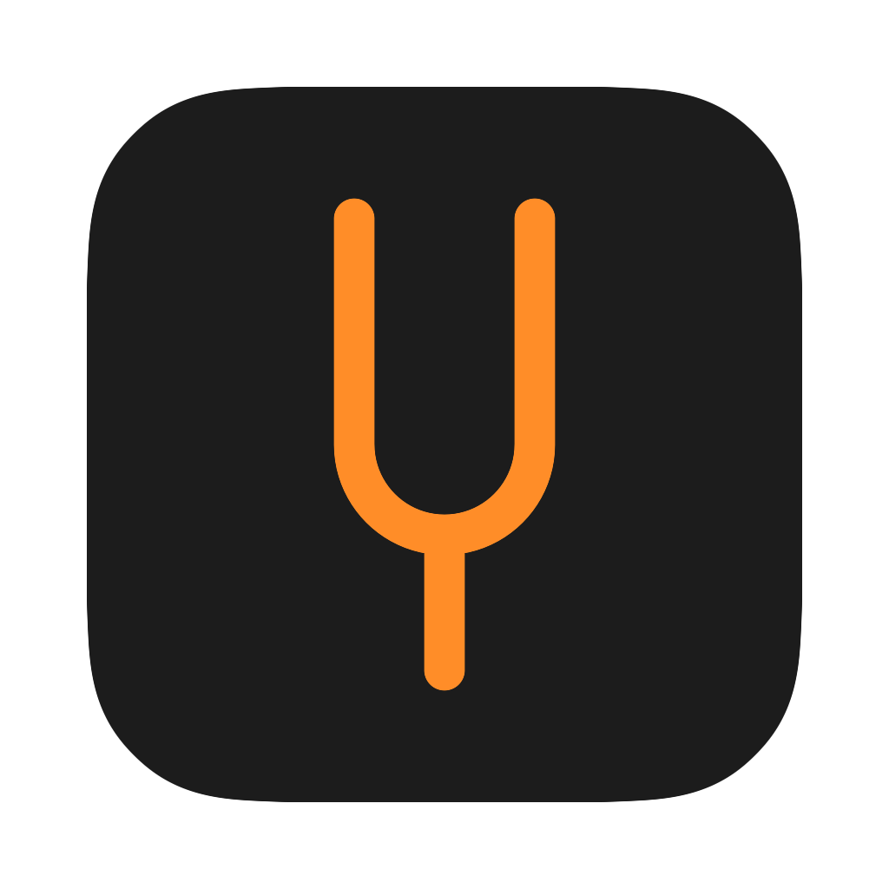
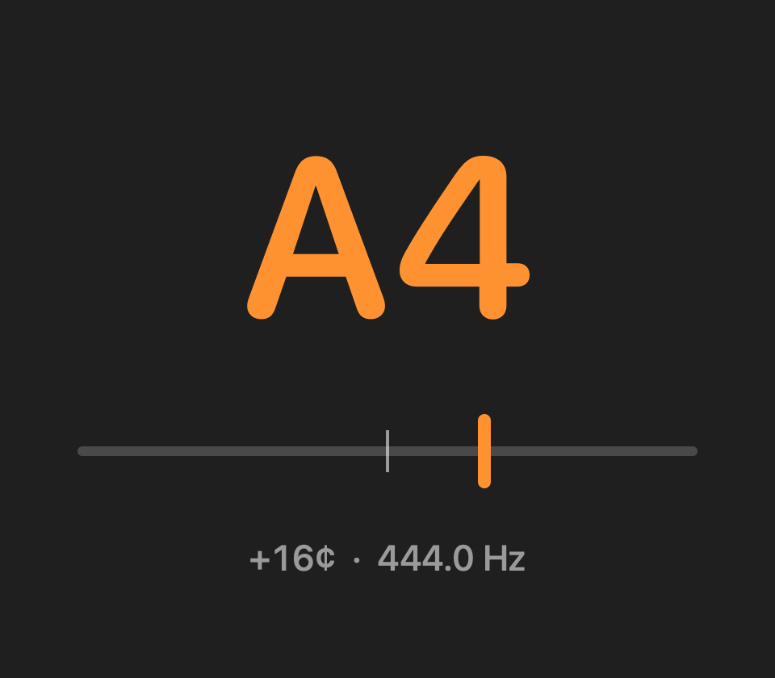

<p align="center"></p>

# Tune

A minimal macOS tuner. Play a note near the microphone; Tune shows the nearest note and how many cents sharp or flat it is. The needle turns green when you're within 5¢.

<p align="center"></p>

## Build

Needs the Xcode Command Line Tools only.

```sh
./build.sh && open build/Tune.app
```

The app is unsigned (ad-hoc) and built locally. It asks for microphone access on first launch.

## License

[GPL-3.0](LICENSE)
